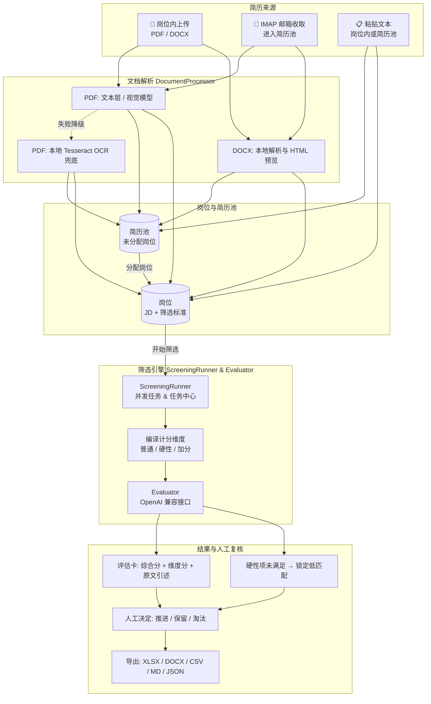

# HireFlow

<p align="center">
  <strong>专门做简历筛选的本地工具：按岗位标准给每份简历打分，每一分都附简历原文证据</strong>
</p>

<p align="center">
  
  
  
  
  
  
</p>

---

HireFlow 只做一件事：**把一批简历按同一套岗位标准筛出来。**

写好岗位 JD 和筛选标准，放入简历，系统逐份调用大模型按固定维度打分，给出综合分、匹配等级、每个维度的判断理由和简历原文引述。推进、保留还是淘汰，始终由你决定。简历和筛选结果都保存在你自己的机器上。

- **适合**：HR、猎头、用人部门面试官，需要在一堆简历里快速找出值得约面的人。
- **不做**：职位发布、面试排期、Offer 审批、员工档案。它不是 ATS，也不替你做录用决定。

---

## 🔎 筛选流程

1. **定标准**：新建岗位，粘贴 JD，写筛选提示词（用「## 1. 名称：XX分」标题或带权重列的表格）。系统把它编译成固定的计分维度，每个维度可设为普通、**硬性 Must-have** 或**加分项**；识别不到权重时使用默认 6 个维度。
2. **放简历**：在岗位里批量上传 PDF / DOCX，或直接粘贴简历文本；也可以把简历池里的简历分配到岗位。
3. **批量筛选**：勾选简历一键筛选，后台并发评分（默认 5 份同时进行）。「筛选结果」页顶部和「任务中心」实时显示进度，失败的单份可以单独重试，不影响整批。
4. **看证据复核**：每份结果是一张评估卡，右侧并排显示原始简历，逐条核对后标记**待复核 / 推进 / 保留 / 淘汰**并写备注。
5. **导出**：勾选候选人或全部导出为 **XLSX / DOCX / CSV / Markdown / JSON**，交给用人部门。

## 📋 评估卡里有什么

- 综合分（0–100）、匹配等级与一句话结论
- 每个维度的独立分数、加权贡献，以及「满足 / 部分 / 不满足 / 未知」的判断
- 每条判断对应的**简历原文引述和位置**（页码或段落）
- 优势、缺口、需要核实的风险点、建议的面试追问
- 名企 / 名校背景标签（同样附原文证据）

## 🧮 分数怎么算

- 模型只给每个维度的 0–100 分和原文证据，**不输出总分**；综合分由后端按 `维度分 × 权重 ÷ 100` 累加，再加名企 / 名校背景加分（最多 5 分），封顶 100。
- 匹配等级：≥ 85 为高匹配，≥ 65 为中匹配，其余为低匹配；**任一硬性项「不满足」直接锁定为低匹配**并标红。
- 性别、年龄只在简历明确写出时提取，仅用于简历池的档案筛选，**不参与任何维度评分**。

## 🧰 围绕筛选的辅助能力

- **重评**：修改岗位标准后可重新评分；重评期间保留上一次有效分数，并在该行标注「重评中」。也可以「更换职位重新评分」，按另一个岗位的标准再评一次，原岗位的评分保留。
- **解析可校对**：PDF 优先读取文本层，扫描页交给视觉模型识别，失败时降级为本地 Tesseract OCR；DOCX 本地解析。解析出的文本可以在界面上人工修正，之后评分使用修正版。
- **简历来源**：
  - 岗位内上传（单文件不超过 20 MB，每个岗位最多 200 份）或粘贴文本（粘贴后立即评分）。
  - 「简历池」汇集邮箱自动收取（IMAP）和粘贴入池的简历，按姓名 / 邮箱 / 手机号提示疑似重复，分配到岗位后再评估；可按分数、年龄、性别、曾评估岗位筛选。
- **回收站**：删除的岗位、简历、任务和评分保留 30 天，可随时恢复。
- **模型可换**：使用 OpenAI 兼容接口，可接 OpenAI、DeepSeek 或企业自建网关；在页面「模型设置」里填 Key 和地址后，从接口返回的模型列表中选择。

---

## 🏗️ 架构与数据流转



---

## 🚀 快速上手

### 方式一：Docker Compose（推荐）

Docker Compose 已配好应用服务、PostgreSQL 17 数据库和中英文 Tesseract OCR：

```bash
# 1. 获取代码
git clone https://github.com/peanut2001/psychic-flow.git
cd psychic-flow

# 2. 复制配置文件，按需编辑（模型 Key 也可以启动后在页面里填写）
cp .env.example .env

# 3. 启动
docker compose up -d --build
```

- 浏览器访问 **`http://127.0.0.1:8000`**。
- 点击首页右上角的模型状态打开「模型设置」：填写 API Key 和接口地址，点「获取模型」后从列表中选择文本模型与视觉模型，可先「测试连接」再保存。
  - 配置只保存在当前浏览器（localStorage），每次操作随请求头发给本机后端，后端不保存。
  - 简历池身份提取、邮箱附件识图等不由页面发起的后台任务拿不到页面配置，只读取 `.env`。
- 首次构建需要下载 OCR 语言包，大约 2~3 分钟。
- 本机 `8000` 端口被占用时，在 `.env` 中设置 `APP_PORT=8010` 等其他端口。

**启停与数据**：
```bash
docker compose down          # 停止服务，数据保留
docker compose logs -f app   # 查看实时日志
```
> **注意**：岗位、筛选结果与简历原件保存在 PostgreSQL 数据卷和 `data/` 目录中。`docker compose down -v` 会删除数据库卷，除非确定要清空，否则不要执行。

### 方式二：本地开发

前置依赖：Python ≥ 3.11、Node.js ≥ 18；可选安装 Tesseract OCR（扫描版 PDF 的本地兜底）。

**后端（FastAPI + SQLite）**：
```bash
python3 -m venv .venv
source .venv/bin/activate
pip install -e '.[dev]'
DATABASE_URL=sqlite:///data/hireflow.db DATA_DIR=data uvicorn app.main:app --reload --port 8000
```

**前端（React + Vite）**：
```bash
cd frontend
npm install
npm run dev
```
开发服务器运行在 `http://127.0.0.1:5173`，`/api` 请求通过 Vite 代理转发到 `127.0.0.1:8000`。

---

## ⚙️ 环境变量

在项目根目录的 `.env` 中配置。模型相关的四项（Key、地址、文本模型、视觉模型）如果在页面「模型设置」中填写，则以页面配置为准：

| 配置项 | 默认值 / 示例 | 说明 |
|---|---|---|
| **`OPENAI_API_KEY`** | `sk-...` | 调用评估与解析模型的 API Key。可留空改在页面填写，但后台身份提取与邮箱附件识图只读此项 |
| **`OPENAI_BASE_URL`** | `https://api.deepseek.com` | OpenAI 兼容接口地址，留空为 OpenAI 官方 |
| **`TEXT_MODEL`** | `gpt-4o-mini` | 评估与维度打分使用的文本模型 |
| **`VISION_MODEL`** | `gpt-4o-mini` | 扫描版 PDF 识别使用的视觉模型 |
| **`VISION_ENABLED`** | `true` | 是否优先用视觉模型识别扫描页（`false` 则直接使用本地 OCR） |
| **`MAX_CONCURRENCY`** | `5` | 同时评分的简历数 |
| **`MAX_FILE_MB`** | `20` | 单份简历文件大小上限（MB） |
| **`MAX_PDF_PAGES`** | `50` | 单份 PDF 解析页数上限 |
| **`MAX_RESUMES_PER_JOB`** | `200` | 单个岗位的简历数量上限 |
| **`MODEL_TIMEOUT_SECONDS`** | `120` | 单次模型调用超时（秒） |
| **`MODEL_MAX_RETRIES`** | `2` | 模型调用失败时的最大重试次数 |
| **`APP_PORT`** | `8000` | Docker 映射到本机的端口 |
| **`IMAP_HOST`** | *选填*，如 `imap.feishu.cn` | 收简历邮箱的 IMAP 服务器 |
| **`IMAP_PORT`** | `993` | IMAP 端口（SSL 通常为 993） |
| **`IMAP_USER`** | *选填*，如 `hr@example.com` | 邮箱账号 |
| **`IMAP_PASSWORD`** | *选填* | 邮箱密码或应用授权码 |
| **`IMAP_POLL_SECONDS`** | `300` | 邮箱拉取间隔（秒） |

---

## 🧪 测试

测试使用 fake evaluator，不调用真实模型、不消耗 Token：

```bash
.venv/bin/pytest -q backend/tests   # 后端单元与接口测试
cd frontend && npm test             # 前端测试（Vitest + Testing Library）
npm run build                       # TypeScript 检查与生产构建
docker compose config               # 校验 Compose 配置
```

---

## 🔒 隐私与公平

1. **简历会发给你配置的模型接口**：评分和扫描页识别需要把简历文本或页面图片发送到所配置的 OpenAI 兼容接口。如果要求数据不出内网，请接入内网部署的模型网关。
2. **其余数据留在本地**：简历原件、解析文本和筛选结果只保存在本机或内网挂载卷中。页面填写的模型 Key 只保存在浏览器，后端不落盘、不写日志。
3. **简历是不可信输入**：评估提示词把简历内容与指令隔离，不向模型提供 shell、联网搜索或文件写入能力。
4. **数据最小化与防偏见**：邮箱收取只记录同步计数，不记录邮件正文；性别与年龄只用于简历池档案筛选，不进入任何评分逻辑。

---

## 📄 开源协议

本项目基于 [MIT License](LICENSE) 开源发布。
